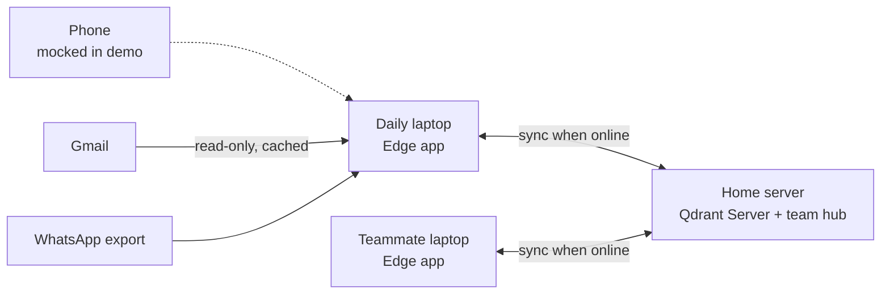
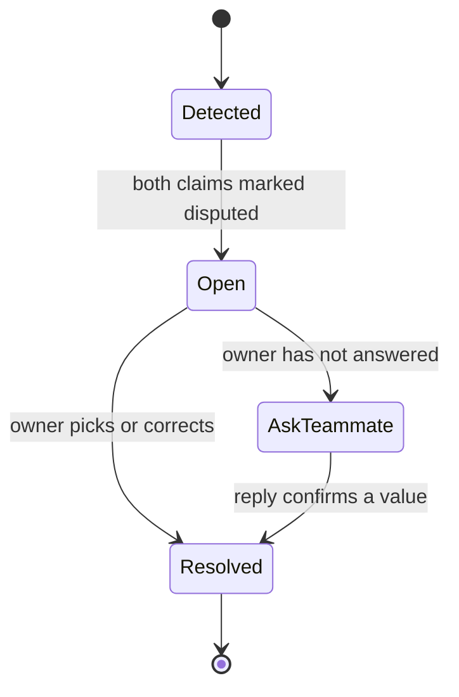

# PS3 Technical Brief: Edge Memory Layer

Sep 24, 2026

## Overview

We are building a private, offline-first memory layer for AI assistants, shown through a personal assistant for people who juggle many projects. It remembers what you were told, notices what you are forgetting, and never silently overwrites a fact that changed.

**Track:** Code Cubicle 6.0, general track, Problem Statement 03 (Qdrant Edge). **Product:** the memory layer. **Showcase:** the assistant app built on it.

**The problem, in our words.** "I run seven projects at once. When one gets interesting, I forget the others exist, including the one with a client deadline. I've missed birthdays. I set reminders to save me, and then I forget to set the reminders." Notes apps, task apps, timers and alarms each hold a piece; none of them remembers for you.

**Why it has to be offline and on-device.** The assistant reads everything: email, WhatsApp, voice notes, what you are working on. That only works if nothing leaves the device unless it has to. It also has to keep working with no signal, as on our Ladakh shoot.

**Pitch lines (draft):**

- "It reads everything, and nothing leaves unless it's work your team needs."
- "An assistant that admits what it doesn't know: when two sources disagree, it asks instead of guessing."

**Framing rule:** tell the experience, not a diagnosis. We do not mention ADHD in the pitch.

## Decisions locked

These are settled; change them only as a team.

| Area | Decision |
| --- | --- |
| Submission | Memory layer is the submission; the assistant app is the showcase |
| Existing code | None reused from the personal Jarvis project; everything built fresh |
| Memory | Knowledge graph plus Qdrant Edge vectors, not vectors and chat history alone |
| Sync tiers | Device only, my devices, BKA team |
| Conflicts | Nothing wins by default; a flagged conflict stays open until actually resolved |
| Who resolves | The task's owner, including for conflicts found at sync time (option C) |
| Unanswered conflicts | Assistant offers "Should I ask X?", drafts the message, sends only on yes |
| WhatsApp | Chat export for real; live notification stream simulated |
| Phone | In scope for the product, mocked for the demo |
| Mocks | Anything is mockable except memory, offline search, sync and conflict handling |
| Honesty | The video states plainly what is mocked |

## Architecture

Each device is a full edge node with its own memory; the home server is the sync hub. Every device keeps working with no network and syncs when it reconnects.



The teammate laptop can be a second app instance on the same machine for the demo, as long as we say so.

| Component | Runs on | Stack | Notes |
| --- | --- | --- | --- |
| Edge app shell | Laptop | Tauri (Rust backend, TypeScript frontend) | Single binary; makes the edge claim credible |
| Vector memory | Laptop | `qdrant-edge` Rust crate | Python bindings are the fallback |
| Embeddings | Laptop | FastEmbed, on-device | Dense vectors plus BM25 sparse vectors for hybrid search |
| Graph and outbox | Laptop | SQLite | Entities, relations, claims, persistent sync queue |
| Local LLM | Laptop | Ollama or llama.cpp, small model | Extraction, classification, answers; never a cloud call |
| Speech in | Laptop | Open-source ASR the hardware can handle | Built fresh for this project |
| Speech out | Laptop | Qwen TTS, local | Check speed with LLM and ASR running together |
| Sync hub | Home server | Qdrant Server in Docker | Holds my-devices and team tiers only |

Pin every package version on day 1. Qdrant Edge is in beta and its API may change.

## Memory model

Every fact is stored as a claim with a source, never as bare truth. That is what lets the system notice when two sources disagree and say who said what.

**Graph (SQLite).** Entities are Person, Project, Task, Event and Source. Relations include OWNS, DUE_ON, ASSIGNED_TO, MENTIONED_IN and ABOUT. A claim attaches one value to one entity attribute, such as a task's due date.

**Vectors (Qdrant Edge).** Each claim and source message becomes a point with named vectors: a dense text vector and a BM25 sparse vector. Hybrid search finds "the Sharma edit" even when worded differently, and links it to the right task entity.

**Claim record (shared contract, both engineers code against this):**

```json
{
  "claim_id": "clm_01J...",
  "entity_id": "task_sharma_edit",
  "attribute": "due_date",
  "value": "2026-10-16",
  "source": {"kind": "email", "ref": "gmail:18f2...", "author": "client:sharma"},
  "stated_at": "2026-10-03T11:20:00+05:30",
  "captured_by": "lakshya",
  "device_id": "dev_lakshya_laptop",
  "tier": "team",
  "status": "active",
  "conflict_id": null,
  "version": 1
}
```

**Outbox record (persistent sync queue):**

```json
{
  "op_id": "op_01J...",
  "claim_id": "clm_01J...",
  "op": "upsert",
  "tier": "team",
  "created_at": "2026-10-03T11:20:05+05:30",
  "attempts": 0,
  "last_error": null
}
```

`status` is one of active, disputed, superseded or retracted. Superseded claims are kept, never deleted, so history stays traceable.

## Sync tiers

Everything starts device-only; a claim moves up a tier only when the local model classifies it as belonging there. That default is what makes "share everything with it" safe.

| Tier | Stored on | Syncs to | Examples |
| --- | --- | --- | --- |
| Device only | This device | Nowhere | Personal photos, financial details, window titles, friends' private news |
| My devices | My devices plus home server | My other devices | Personal schedule, birthdays, personal reminders |
| BKA team | All team devices plus home server | All four of us | Client deadlines, deliverables, shoot schedules, assigned tasks |

**Classification.** On ingest, the local LLM tags each extracted claim with a tier. Anything uncertain stays device-only. The memory inspector shows the tier and lets the user move a claim.

**Up-sync.** Dual write: every change is written locally and added to the persistent outbox. A background worker drains the outbox when the hub is reachable, with retries. Qdrant's own example uses an in-memory queue; ours survives restarts.

**Down-sync.** Devices pull changes from the hub using partial snapshots, which send only changed segments.

## Conflict handling

A conflict is two active claims giving different values for the same entity attribute. No claim wins by default, and a conflict closes only when its owner resolves it.



**Where conflicts are detected.** On ingest, when a new claim contradicts one already on the device. At sync, when claims recorded on separate devices while offline meet for the first time.

**Who is asked.** The task's owner, whoever added the conflicting claims. Every shared task therefore needs an owner.

**While a conflict is open.** Any answer touching it reports both versions and their sources. Example: "Disputed. The client's email says the 16th; you said the 18th on set. Want to settle it?"

**If the owner doesn't answer.** The assistant asks again as the deadline nears, then offers "Should I ask Lakshya?" It drafts the message, and it sends only after a yes. Email goes through the Gmail API; WhatsApp opens a click-to-chat link with the text filled in, and the user taps send.

**On resolution.** The chosen claim becomes active; the other becomes superseded. The resolution itself is stored as a claim, with who resolved it and when.

## Ingestion sources

Every source is processed by the local model, and every extracted claim keeps its source, author and time.

| Source | Demo status | How | Source info kept |
| --- | --- | --- | --- |
| Gmail | Real | Gmail API, read-only; cached locally so it works offline | Sender, time, thread |
| WhatsApp history | Real | Parse the exported chat file (Export chat, without media) | Sender and time on every line |
| WhatsApp live | Simulated | Android notification listener in the product; a replayed stream in the demo | Sender, time |
| Voice notes | Real | Local ASR, then extraction ("the client just said it's due Friday") | Speaker, time |
| Active app and window | Real | Read the active window title and app via a Rust crate | Device only |
| Screen understanding | Mocked | Vision model over the screen in the product | Device only |

We do not use unofficial WhatsApp Web automation. It breaks WhatsApp's terms and risks a ban on a real number. Calls are covered by voice notes after the call, not recordings.

## Proactive behaviours

The hyperfocus nudge is the headline behaviour: a reminders app can't do it. Build these four for the demo and nothing more.

| Behaviour | Trigger | What it says |
| --- | --- | --- |
| Hyperfocus nudge | 3 hours in one project's folder or app while another project has a deliverable due within 24 hours | "You've been on the game project since 2. The Sharma edit is due tomorrow at 10." |
| Deadline reminder | A due date approaches, scaled to how far it is | "Reel cutdowns due Monday. Three, not two, per the client's last message." |
| Person fact | A known date tied to a person | "Riya's birthday is Thursday. Last time you talked about her trip to Goa." |
| One pattern | A repeated miss in the history | "You usually forget invoices on Fridays. Want a reminder at 4?" |

Thresholds are placeholders; tune them once real data is flowing. Names in the examples are invented.

## Privacy and security

Offline is necessary but not sufficient. Three rules make the privacy claim provable instead of a promise.

1. **No leaks through team sync.** Chats hold other people's private information. Only claims classified as BKA work reach the team tier; the rest stay device-only by default.
2. **Encrypted at rest.** Memory, graph and outbox are encrypted on disk, or at minimum the laptop has full-disk encryption on. A stolen laptop must not mean stolen chats.
3. **No cloud calls in the private path.** Extraction, classification and answers run on the local model, even when slower. Gmail needs a network to fetch, but processing is local.

Window titles and app activity never leave the device. For the pitch, show a network monitor at zero traffic during private operations.

## Interface

The problem statement requires an interface to inspect memory, search, sync status and activity. Our job is to make invisible sync visible.

| Surface | Shows | Owner |
| --- | --- | --- |
| Memory point cloud | Every claim as a 3D point placed by meaning, coloured by state: local, queued, synced, conflicted | Tushar |
| Assistant panel | Voice and text conversation, with sources cited under each answer | Tushar |
| Memory inspector | Table of claims with entity, value, source, tier and status; tier editable | Tushar |
| Conflict centre | Open conflicts, both versions side by side, owner, "ask teammate" draft | Tushar |
| Sync status | Per-device online toggle, outbox length, last sync, retries | Tanishk |
| Activity timeline | Claim added, search run, sync started, snapshot applied, conflict resolved | Tanishk |
| Network monitor | Live bytes in and out, proving offline operation on camera | Tanishk |

Point cloud: reduce embeddings to 3D with UMAP or PCA, render with three.js inside the Tauri window. Offline claims appear amber, pulse green on sync, and conflicting pairs flash red and pull together.

## Real vs mocked

The graded parts are real; everything around them can be mocked, and the video says which is which.

| Real (graded) | Mocked (showcase) |
| --- | --- |
| Qdrant Edge memory and hybrid search on the laptop | Phone app and its capture flow |
| Offline operation with the network cut | Live WhatsApp notification stream (replayed) |
| Sync to the home server, persistent outbox, partial snapshots | Screen understanding |
| Conflict detection, ownership, resolution | Task execution beyond reminders and drafted messages |
| Tier classification and device-only data | Long-term pattern learning (one scripted pattern) |
| Gmail ingest, WhatsApp export parsing, voice notes | Multiple teammates (second app instance) |
| Active-window tracking and the hyperfocus nudge | |

## Build split and week plan

Tanishk leads and owns memory, sync and conflicts; Tushar owns the frontend and visuals. Aayat and Lakshya join on the final day for the film.

| Day | Tanishk | Tushar |
| --- | --- | --- |
| 1 | Prove Qdrant Edge in Rust (fallback Python), FastEmbed on-device, one sync round-trip | Tauri shell, design system, interface wireframes |
| 2 | Claim contract, SQLite graph, persistent outbox | Memory inspector and assistant panel on mock data |
| 3 | Ingest: Gmail, WhatsApp export, voice notes; tier classification | Point cloud prototype with UMAP coordinates |
| 4 | Conflict detection at ingest and sync; owner routing | Conflict centre, sync status; **mid-point check against cut lines** |
| 5 | Hyperfocus nudge, reminders, ask-teammate drafts | Wire every surface to live data |
| 6 | End-to-end demo runs, bug fixes, **feature freeze** | Polish, motion, pitch deck visuals |
| 7 | Filming support, submission | Motion graphics for the film |

Claude Code (Max) goes on the sync engine, conflict logic and code review. Antigravity handles interface and boilerplate. Both tools read the same conventions file in the repo.

## Demo script

Three minutes, one continuous story: a shoot in a no-signal location, a changed deadline, and a conflict the assistant refuses to guess about.

1. **Hook (20 s).** The seven-projects story, told straight to camera.
2. **It already knows (25 s).** Ask "what's due this week?" Answer cites the client email and a WhatsApp message.
3. **Go offline (30 s).** Airplane mode on screen, network monitor at zero. Search still answers in milliseconds.
4. **New memory offline (20 s).** Voice note: "Client says push the Sharma delivery to the 18th." Point turns amber, outbox shows one item.
5. **Hyperfocus nudge (20 s).** Hours in the fun project; the assistant speaks up about tomorrow's deliverable.
6. **Meanwhile (15 s).** The second instance, Lakshya, logs the client's email: delivery confirmed for the 16th.
7. **Reconnect (30 s).** The outbox drains, points pulse green, two points flash red and pull together. The task owner is asked.
8. **No guessing (25 s).** "Disputed. Email says the 16th; you said the 18th on set." It offers "Should I ask the client?", drafts it, sends on yes. Resolved.
9. **Close (15 s).** The assistant is the showcase; the memory layer is the product, for any device that must remember offline: robots, kiosks, vehicles, field tools.

Record the full run at least twice. Keep the fastest clean take of each step.

## Risks, cut lines and open questions

The biggest risk is scope, not skill: every feature that doesn't touch memory or sync scores nothing this week.

| Risk | Mitigation |
| --- | --- |
| Qdrant Edge beta API changes | Pin the version on day 1; no upgrades mid-hackathon |
| AI coding tools invent Edge methods | Load Qdrant's docs, agent skills and Edge examples into both tools before generating code |
| Rust crate or on-device embeddings in Rust fall short | Switch to Python bindings with a web UI by end of day 1 |
| ASR, LLM and TTS compete for laptop resources | Test all three running together on day 3 |
| Wrong task matched to a message | Show the match with its source; let the user correct it |
| Turning the week into finishing Jarvis | Anything not in Real vs mocked waits until after submission |

**Cut lines (decide at the day-4 check):**

- Sync-time conflicts not working → keep ingest-time conflicts, show the sync ones in the log only.
- Point cloud not ready → a 2D version of the same colour states.
- Gmail auth fighting us → a saved export of real emails.

**Open questions:**

- [ ] Exact submission deadline and required materials for the general track
- [ ] Is there a Qdrant-specific prize, or only the general pool?
- [ ] Does Qwen TTS run fast enough offline next to the LLM?
- [ ] Does FastEmbed work on-device from Rust, or do we need Python for embeddings?
- [ ] Timing for re-asking an unanswered conflict
- [ ] Hyperfocus trigger: is 3 hours with another deliverable due within 24 hours right, or should it fire sooner?
- [ ] Product name (not "Jarvis")

**Sources:** [Qdrant Edge documentation](https://qdrant.tech/documentation/edge/) · [Qdrant Edge data synchronization patterns](https://qdrant.tech/documentation/edge/edge-data-synchronization-patterns/) · [Qdrant Vector Space Hackathon 2026 winners](https://qdrant.tech/blog/vector-space-hackathon-winners-2026/) · [Code Cubicle 6.0 on HackCulture](https://hackculture.io/hackathons/code-cubicle-6-0)
